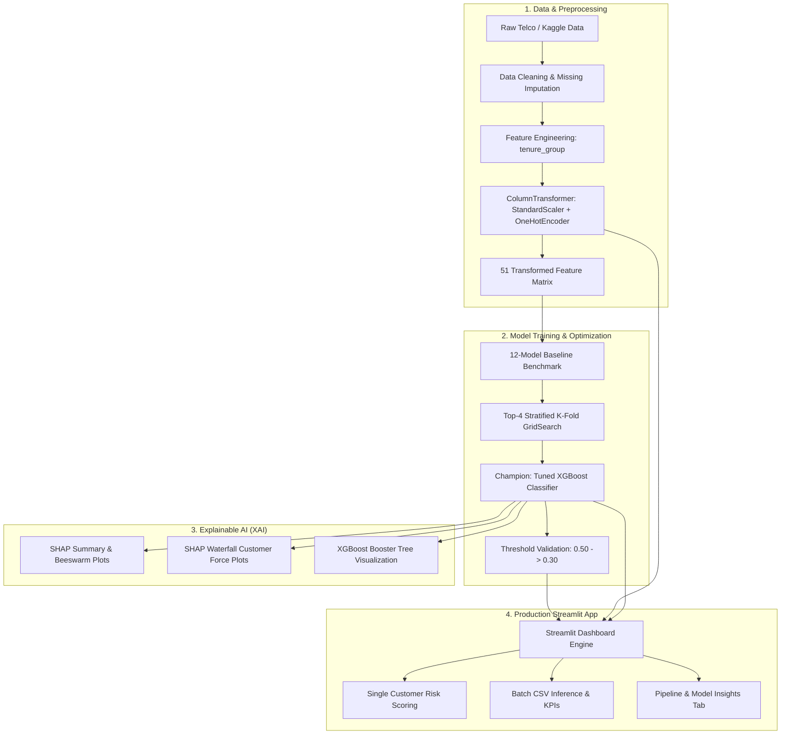

<div align="center">

# 🔮 ChurnIQ

### **AI-Powered Customer Churn Prediction & Retention Intelligence System**

[](https://www.python.org/)
[](https://xgboost.readthedocs.io/)
[](https://scikit-learn.org/)
[](https://streamlit.io/)
[](https://shap.readthedocs.io/)
[](https://plotly.com/)

<p align="center">
  <b>A comprehensive, production-grade machine learning system designed to predict customer attrition, diagnose churn drivers through Explainable AI (SHAP), optimize decision thresholds for maximum business recall, and empower retention teams via an interactive Streamlit dashboard.</b>
</p>

[Key Features](#-key-features) •
[Architecture](#-system-architecture) •
[Data Science Pipeline](#-end-to-end-pipeline--notebook-walkthrough) •
[Model Benchmarks](#-model-benchmarks--performance) •
[Threshold Strategy](#-threshold-optimization-why-030-recall-matters) •
[Streamlit App](#-streamlit-web-application) •
[Getting Started](#-getting-started--installation)

---

</div>

## 📌 Executive Summary

Customer acquisition costs (**CAC**) in the telecommunications and subscription software industries are **5× to 7× higher** than customer retention costs. Unchecked customer attrition directly erodes monthly recurring revenue (**MRR**) and enterprise valuation.

Standard machine learning classification models defaulted at a **0.50 decision threshold** routinely miss over **46% of churning customers** (high False Negatives). For retention teams, a missed churner costs hundreds of dollars in lost lifetime value, whereas a false positive merely triggers a proactive discount or service call.

**ChurnIQ** resolves this structural asymmetry by:
1. Benchmarking **12 candidate algorithms** and hyperparameter-tuning a champion **XGBoost Classifier** (`ROC-AUC: 0.838`).
2. Optimizing the classification threshold from `0.50` down to `0.30`, boosting **Churn Recall from 53.2% to 76.5%** on held-out test data (+23.3% lift) and achieving **89% recall** on large-scale validation data.
3. Leveraging **SHAP (SHapley Additive exPlanations)** to explain global and granular prediction factors.
4. Delivering a **responsive Streamlit web application** supporting single-customer simulation, high/low risk presets, batch CSV inference, automated schema sanitization, and revenue-at-risk analytics.

---

## 🚀 Key Features

- **🏆 Tuned XGBoost Engine:** Stratified K-Fold grid-searched gradient boosted tree architecture calibrated for high tabular predictive power.
- **🎯 Business-Calibrated Thresholding:** Dynamic decision threshold presets (`Tuned 0.30`, `Balanced 0.40`, `Conservative 0.50`, or custom slider) to align precision/recall with business economics.
- **🔍 Explainable AI (XAI):** Global feature importances, SHAP summary beeswarm plots, individual waterfall force plots, and tree structural diagrams.
- **⚡ Dual-Mode Streamlit App:**
  - **Single Customer Scoring:** Real-time form with automatic feature derivation, high/low risk demo presets, interactive Plotly gauge meter, and risk tier badges.
  - **Batch CSV Inference:** Upload datasets or load the 200-sample Kaggle competition test set; view executive KPIs, revenue at risk ($), risk distribution donut charts, and export enriched predictions with one click.
- **🛡️ Robust Preprocessing Pipeline:** Automatic case-insensitive column mapping, tenure cohort derivation (`1 - 12`, `13 - 24`, etc.), missing `TotalCharges` imputation, and `SeniorCitizen` encoding normalization.
- **📊 Exhaustive 8-Stage Notebook Suite:** Documenting the end-to-end lifecycle from raw data hygiene, EDA, preprocessing, training, hyperparameter tuning, validation, explainability, to visualization.

---

## 🏗️ System Architecture



---

## 🔬 End-to-End Pipeline & Notebook Walkthrough

The project is structured into **8 sequentially organized Jupyter notebooks**, representing a rigorous, production-grade data science workflow:

| Notebook | Focus Area | Key Highlights & Methodologies |
| :--- | :--- | :--- |
| [`01_Data_Cleaning_and_EDA.ipynb`](./01_Data_Cleaning_and_EDA.ipynb) | **Data Cleaning & Exploratory Data Analysis** | • 7,043 raw records, 21 columns analyzed.<br>• Identified and coerced 11 whitespace `TotalCharges` records.<br>• Engineered `tenure_group` into six 12-month cohorts.<br>• Detected primary churn indicators: Month-to-month contracts, fiber optic without tech support, electronic check payments. |
| [`02_Preprocessing_and_train_test_split.ipynb`](./02_Preprocessing_and_train_test_split.ipynb) | **Preprocessing & Stratified Splitting** | • 80/20 Stratified train/test split preserving ~26.5% churn ratio.<br>• Built `ColumnTransformer` with `StandardScaler` (charges) and `OneHotEncoder` (17 categoricals).<br>• Output feature dimension: **51 encoded features**.<br>• Serialized `preprocessor.pkl`, `X_train.pkl`, `X_test.pkl`, `y_train.pkl`, `y_test.pkl`. |
| [`03_Model_training.ipynb`](./03_Model_training.ipynb) | **Multi-Model Baseline Training** | • Trained and evaluated **12 candidate algorithms**.<br>• Generated full train and test classification metrics (Accuracy, Precision, Recall, F1, ROC-AUC).<br>• Shortlisted top-performing candidates for fine-tuning. |
| [`04_hyperparameter_tuning.ipynb`](./04_hyperparameter_tuning.ipynb) | **Stratified K-Fold Hyperparameter Tuning** | • Executed GridSearchCV across Logistic Regression, AdaBoost, Gaussian Naive Bayes, and XGBoost.<br>• **XGBoost selected as Champion** with optimal CV ROC-AUC: `0.8509`.<br>• Serialized `models/tuned_xgboost.pkl`. |
| [`05_Threshold_validation.ipynb`](./05_Threshold_validation.ipynb) | **Precision-Recall & Threshold Validation** | • Evaluated decision boundaries from `0.05` to `0.95`.<br>• Validated `0.30` optimal threshold on held-out test data and a massive 594,000+ record competition dataset.<br>• Reduced false negatives from 37,909 down to 14,153 (62.7% reduction in missed churners). |
| [`06_Explainable_AI.ipynb`](./06_Explainable_AI.ipynb) | **Model Interpretability with SHAP** | • Computed SHAP values for global feature impact.<br>• Generated SHAP beeswarm, summary, and individual waterfall plots.<br>• Formulated business-friendly feature translation and deployment troubleshooting guidelines. |
| [`07_XGBoost_Model_Performance_Dashboard.ipynb`](./07_XGBoost_Model_Performance_Dashboard.ipynb) | **Evaluation Suite & Diagnostics** | • Evaluated Confusion Matrix, ROC-AUC Curves, Precision-Recall Curves.<br>• Assessed Brier Score calibration (`0.1389`).<br>• Exported evaluation artifacts to `reports/xgboost_test_metrics.csv`. |
| [`08_XGBoost_Visualization.ipynb`](./08_XGBoost_Visualization.ipynb) | **Tree Structure & Graph Visualization** | • Extracted Booster trees from the tuned estimator.<br>• Generated high-resolution decision tree diagrams saved in `reports/tree_visualizations/`. |

---

## 📊 Model Benchmarks & Performance

### 1. Initial 12-Model Baseline Comparison (Test Set)

| Model | Accuracy | Precision | Recall | F1 Score | ROC-AUC |
| :--- | :---: | :---: | :---: | :---: | :---: |
| **XGBoost (Baseline)** | 0.7910 | 0.6270 | 0.5214 | 0.5693 | 0.8354 |
| **AdaBoost** | 0.7953 | 0.6396 | 0.5267 | 0.5777 | 0.8344 |
| **Logistic Regression** | 0.7932 | 0.6361 | 0.5187 | 0.7860 | 0.7056 |
| **Random Forest** | 0.7825 | 0.6179 | 0.4840 | 0.5427 | 0.8190 |
| **SVC (Linear)** | 0.7861 | 0.6327 | 0.4652 | 0.7746 | 0.6837 |
| **SVC (Poly)** | 0.7854 | 0.6192 | 0.5000 | 0.7775 | 0.6943 |
| **SVC (RBF)** | 0.7839 | 0.6316 | 0.4492 | 0.7711 | 0.6772 |
| **Gradient Boosting** | 0.7882 | 0.6254 | 0.4947 | 0.5524 | 0.8329 |
| **Gaussian Naive Bayes** | 0.6894 | 0.4535 | **0.8209** | 0.5842 | 0.8078 |
| **Bernoulli Naive Bayes** | 0.7605 | 0.5367 | 0.7166 | 0.6136 | 0.8143 |
| **Decision Tree** | 0.7164 | 0.4691 | 0.5080 | 0.7199 | 0.6499 |
| **SVC (Sigmoid)** | 0.7278 | 0.4878 | 0.4813 | 0.7272 | 0.6492 |

---

### 2. Tuned Models Benchmark (GridSearchCV on Held-Out Test Set)

Following stratified cross-validation hyperparameter search:

| Model | Accuracy | Precision | Recall | F1 Score | Test ROC-AUC |
| :--- | :---: | :---: | :---: | :---: | :---: |
| **🏆 XGBoost (Tuned)** | **0.7953** | **0.6378** | **0.5321** | **0.5802** | **0.8378** |
| **AdaBoost** | 0.7953 | 0.6396 | 0.5267 | 0.5777 | 0.8344 |
| **Logistic Regression** | 0.7918 | 0.6401 | 0.4947 | 0.5581 | 0.8306 |
| **Gaussian Naive Bayes** | 0.6894 | 0.4535 | 0.8209 | 0.5842 | 0.8078 |

#### Tuned XGBoost Hyperparameters:
```python
{
    'n_estimators': 100,
    'learning_rate': 0.1,
    'max_depth': 2,
    'subsample': 0.7,
    'colsample_bytree': 0.4,
    'random_state': 42
}
```
*Best CV ROC-AUC:* **0.8509** | *Test ROC-AUC:* **0.8378** | *Brier Score:* **0.1389**

---

## 🎯 Threshold Optimization: Why 0.30 Recall Matters

In telecommunications, missing a churner who leaves for a competitor (**False Negative**) results in lost lifetime revenue ($500–$2,000+), whereas offering a loyalty discount to a customer who might have stayed (**False Positive**) costs very little ($20–$50).

### Threshold Sensitivity Analysis (Tuned XGBoost)

| Decision Threshold | Accuracy | Precision | Recall | F1 Score | Business Strategy Context |
| :---: | :---: | :---: | :---: | :---: | :--- |
| `0.20` | 0.6859 | 0.4522 | 86.10% | 0.5930 | Ultra-Aggressive Retention Campaign |
| `0.25` | 0.7150 | 0.4789 | 81.82% | 0.6041 | High-Growth Focus |
| **`0.30` (Tuned)** | **0.7377** | **0.5044** | **76.47%** | **0.6079** | **Optimal Balanced Recall Strategy** |
| `0.35` | 0.7711 | 0.5533 | 72.19% | 0.6265 | Peak F1 Threshold |
| `0.40` | 0.7846 | 0.5835 | 66.31% | 0.6208 | Balanced Standard |
| **`0.50` (Default)** | **0.7953** | **0.6378** | **53.21%** | **0.5802** | **Standard Default (Misses ~47% Churners)** |

### 📈 The Business Impact of Shifting to 0.30:
- **+23.3% Lift in Recall:** Catches over **3 out of 4 churning customers** on the test set.
- **Large-Scale Validation:** On the 594,000+ record Kaggle dataset, the 0.30 threshold increased recall to **89%**, slashing missed churners from **37,909 down to 14,153** (a **62.7% drop in lost accounts**).

---

## 🔍 Explainable AI & Key Churn Drivers

Using **SHAP (SHapley Additive exPlanations)** and tree feature importances, ChurnIQ exposes the underlying behavioral signals driving customer decisions:

### 🚨 Top Churn Risk Drivers (High Hazard Signals):
1. **Contract Type:** `Month-to-month` contracts exhibit an average churn rate of **~42.7%**. Absence of long-term commitment is the single largest predictor of customer loss.
2. **Tenure Cohort:** Customers in their first year (`1 - 12 months`) face peak attrition risk (**~47.4%** churn probability).
3. **Internet Infrastructure:** Customers on `Fiber optic` without security add-ons churn at **~41.9%**, primarily driven by high pricing without perceived value.
4. **Payment Channel:** Customers paying via `Electronic check` experience **~45.3%** churn, correlating with unautomated billing friction.
5. **No Tech Support / No Online Security:** Absence of support services doubles customer churn vulnerability.

### 🛡️ Top Retention Anchors (Loyalty Drivers):
1. **Long-Term Contracts:** `Two-year` contracts exhibit a churn rate below **3%**.
2. **Tenure Maturity:** Customers past 4 years (`49 - 72 months`) show high brand stability.
3. **Automated Payments:** `Credit card (automatic)` and `Bank transfer (automatic)` significantly reduce involuntary and voluntary churn.
4. **Service Bundling:** Active subscriptions to `Tech Support`, `Online Backup`, and `Online Security` create high switching barriers.
5. **Multi-User Households:** Customers with `Partner: Yes` or `Dependents: Yes` show higher account retention.

---

## 💻 Streamlit Web Application

The interactive web dashboard (`app.py`) provides an executive-ready interface for data analysts, customer success managers, and retention executives:

```bash
streamlit run app.py
```

### 🖥️ Application Features & Walkthrough:

#### 1. Single Customer Prediction (Tab 1)
- **1-Click Demo Presets:** Instantly load a **"High Churn Risk"** profile (Month-to-month, Fiber optic, New customer, Electronic check) or a **"Low Churn Risk"** profile (Two-year contract, DSL, Long tenure, Auto-pay).
- **Interactive Form Inputs:** Demographics, Telecom services, Contract type, Paperless billing, and Charges.
- **Auto-Derivations:** Automatically derives `tenure_group` from raw `tenure` and calculates expected `TotalCharges`.
- **Real-Time Visuals:** Plotly color-coded gauge chart with dynamic threshold line, Risk Level badges (`High`, `Medium`, `Low`), and churn probability score.

#### 2. Batch CSV Inference (Tab 2)
- **Flexible Ingestion:** Upload any customer CSV or click to load 200 real competition records from Kaggle test data.
- **Robust Pipeline:** Tolerates case variations, auto-imputes missing `TotalCharges`, handles both `0/1` and string `SeniorCitizen` formats, and preserves customer IDs.
- **Executive KPI Dashboard:**
  - `Customers Analyzed`
  - `Predicted Churners` & Churn Rate (%)
  - `High Risk Accounts` (%)
  - `Monthly Revenue at Risk ($)`
- **Visual Analytics:** Interactive Risk Distribution Donut Chart & Churn Probability Histogram with threshold marker.
- **Filter & Export:** Filter predictions by risk tier and download the full enriched dataset with 1 click.

#### 3. Model & Notebook Insights (Tab 3)
- Complete walkthrough of the 5-stage modeling lifecycle.
- Tuned model performance benchmark table.
- Interactive explanation of the business rationale behind the `0.30` threshold.
- Horizontal bar chart of the **Top 12 Features Driving XGBoost Predictions**.

#### 4. Dynamic Sidebar Controls
- Select threshold preset: `Tuned (0.30 - High Recall)`, `Balanced (0.40)`, `Conservative (0.50)`, or configure a `Custom Slider` (0.10 – 0.90).
- Live architecture and metric summary card.

---

## 📂 Repository Structure

```plaintext
ChurnIQ/
├── 01_Data_Cleaning_and_EDA.ipynb                  # Data hygiene, missing imputation & EDA
├── 02_Preprocessing_and_train_test_split.ipynb     # Preprocessor pipeline & train/test split
├── 03_Model_training.ipynb                         # 12-model baseline benchmark
├── 04_hyperparameter_tuning.ipynb                  # Stratified K-Fold GridSearchCV
├── 05_Threshold_validation.ipynb                   # Precision-Recall & competition validation
├── 06_Explainable_AI.ipynb                         # SHAP explanations & feature attribution
├── 07_XGBoost_Model_Performance_Dashboard.ipynb    # Comprehensive evaluation dashboard
├── 08_XGBoost_Visualization.ipynb                  # XGBoost tree graph visualization
├── app.py                                          # Full-featured Streamlit web application
├── requirements.txt                                # Production dependencies
├── Models_result.txt                               # Detailed logs for 12 baseline models
├── Tuned_Models_results.txt                        # Detailed logs for 4 tuned models
├── explainableAI.txt                               # Reporting guidelines & XAI troubleshooting
├── Dataset/
│   ├── WA_Fn-UseC_-Telco-Customer-Churn.csv       # Raw Telco customer churn dataset
│   ├── churn_data.csv                              # Cleaned dataset with tenure cohorts
│   ├── threshold_data.csv                          # Threshold sensitivity metrics
│   ├── tuned_model_comparison.csv                  # Cross-model evaluation comparison
│   ├── X_train.pkl / X_test.pkl                    # Preprocessed feature splits
│   ├── y_train.pkl / y_test.pkl                    # Target label splits
│   └── kaggle_competition_dataset/                 # Large-scale validation data (train & test)
├── models/
│   ├── tuned_xgboost.pkl                           # Champion tuned XGBoost model
│   ├── preprocessor.pkl                            # Scikit-Learn ColumnTransformer pipeline
│   ├── threshold.pkl                               # Active optimal threshold value (0.30)
│   └── xgboost_threshold.pkl                       # Serialized threshold metadata
└── reports/
    ├── Customer_Churn_Prediction_Project_Report.pdf# Full project summary documentation
    ├── xgboost_test_metrics.csv                    # Final test set evaluation metrics
    ├── xgboost_threshold_analysis.csv              # Threshold sweep metrics (0.05 - 0.95)
    └── tree_visualizations/
        └── xgboost_tree_0_depth_3.png              # Visual diagram of tree decision logic
```

---

## ⚙️ Getting Started & Installation

### 1. Prerequisites
- **Python 3.10+**
- `git`

### 2. Clone Repository
```bash
git clone https://github.com/Kartikagarwal453/ChurnIQ.git
cd ChurnIQ
```

### 3. Create & Activate Virtual Environment
```bash
# Windows
python -m venv venv
.\venv\Scripts\activate

# macOS / Linux
python3 -m venv venv
source venv/bin/activate
```

### 4. Install Dependencies
```bash
pip install -r requirements.txt
```

*Optional packages for notebook execution and SHAP interpretability:*
```bash
pip install shap matplotlib seaborn jupyter
```

### 5. Launch the Streamlit Web App
```bash
streamlit run app.py
```
Open your browser at `http://localhost:8501`.

### 6. Explore the Notebooks
```bash
jupyter notebook
```
Navigate to any notebook from `01_Data_Cleaning_and_EDA.ipynb` to `08_XGBoost_Visualization.ipynb`.

---

## 📋 Data Schema

The dataset represents telecommunications customer account attributes:

| Feature Name | Type | Description / Valid Values |
| :--- | :--- | :--- |
| `gender` | Categorical | `Male`, `Female` |
| `SeniorCitizen` | Categorical | `No`, `Yes` (or binary `0`, `1`) |
| `Partner` | Categorical | `Yes`, `No` |
| `Dependents` | Categorical | `Yes`, `No` |
| `tenure` | Numeric | Customer subscription length in months (`1` to `72`) |
| `tenure_group` | Categorical | Cohort bin (`1 - 12`, `13 - 24`, `25 - 36`, `37 - 48`, `49 - 60`, `61 - 72`) |
| `PhoneService` | Categorical | `Yes`, `No` |
| `MultipleLines` | Categorical | `No`, `Yes`, `No phone service` |
| `InternetService`| Categorical | `DSL`, `Fiber optic`, `No` |
| `OnlineSecurity` | Categorical | `No`, `Yes`, `No internet service` |
| `OnlineBackup` | Categorical | `No`, `Yes`, `No internet service` |
| `DeviceProtection` | Categorical | `No`, `Yes`, `No internet service` |
| `TechSupport` | Categorical | `No`, `Yes`, `No internet service` |
| `StreamingTV` | Categorical | `No`, `Yes`, `No internet service` |
| `StreamingMovies` | Categorical | `No`, `Yes`, `No internet service` |
| `Contract` | Categorical | `Month-to-month`, `One year`, `Two year` |
| `PaperlessBilling` | Categorical | `Yes`, `No` |
| `PaymentMethod` | Categorical | `Electronic check`, `Mailed check`, `Bank transfer (automatic)`, `Credit card (automatic)` |
| `MonthlyCharges` | Numeric | Monthly bill in USD ($) |
| `TotalCharges` | Numeric | Cumulative charges in USD ($) |
| `Churn` *(Target)* | Categorical | `Yes` (1), `No` (0) |

---

## 💡 Strategic Retention Playbook

Based on the quantitative findings of ChurnIQ, retention teams should execute the following targeted interventions:

1. **Onboarding Milestones (First 12 Months):**
   - Provide milestone incentives (e.g., free premium security add-on at Month 3 and Month 6).
   - Early onboarding health check-ins reduce the ~47% first-year churn spike.
2. **Contract Migration Incentives:**
   - Offer a modest discount or bill credit to migrate Month-to-month subscribers into 1-year or 2-year contracts.
3. **Fiber Optic Service Bundling:**
   - Fiber optic users churn when pricing feels disconnected from stability. Bundle free `TechSupport` and `OnlineSecurity` during initial fiber installations.
4. **Auto-Pay Conversion Promos:**
   - Incentivize electronic check users to enroll in automatic bank transfers or credit cards with a recurring $2–$5 monthly discount.

---

## 🛠️ Technology Stack

- **Core:** Python 3.10+
- **Machine Learning & Preprocessing:** Scikit-Learn, XGBoost, NumPy, Pandas, Joblib
- **Explainability (XAI):** SHAP, Matplotlib, Seaborn
- **Web Application & UI:** Streamlit, Plotly Express & Graph Objects
- **Notebook Development:** Jupyter Notebooks, IPython

---

## 📄 License & Attribution

This project was developed for educational and portfolio demonstration purposes. The Telco Customer Churn dataset is publicly provided via IBM Cognos Analytics and Kaggle.

Developed with ❤️ by **[Kartik Agarwal](https://github.com/Kartikagarwal453)**.